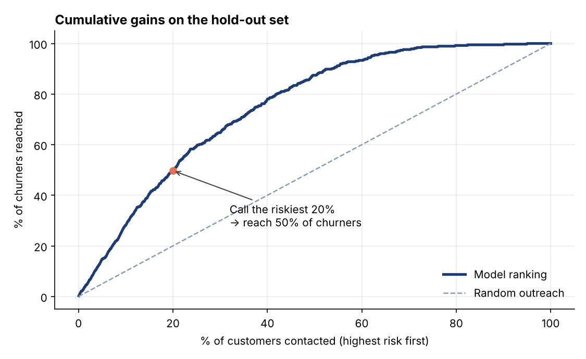
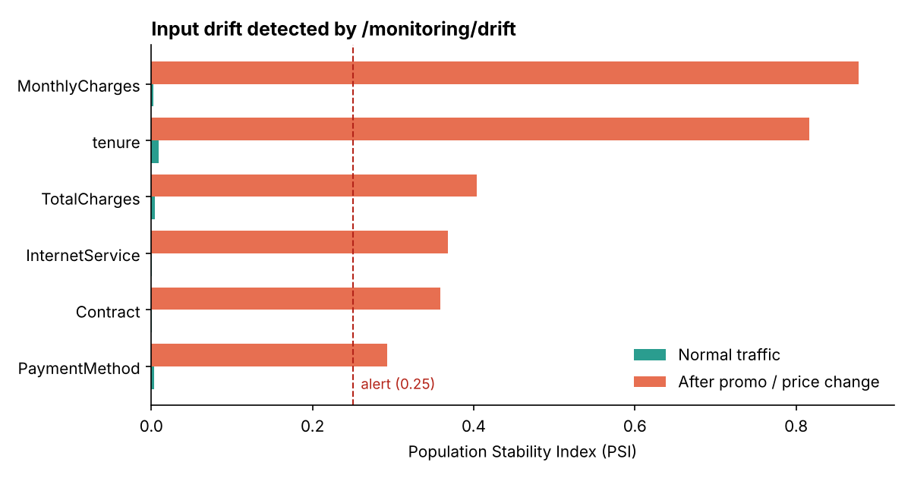

# 📉 Churn Model API: from notebook to a monitored production service


My [churn prediction notebook](https://github.com/Bellomk77/customer-churn-prediction), turned into what a real team would deploy: a **validated REST API** that scores customers, **explains every score**, **logs every prediction**, and **detects data drift**, with a model card and a CI quality gate that blocks a worse model from shipping.

Trained on the **IBM Telco Customer Churn** dataset (7,043 real-world-style customer records, 26.5% churn).



---

## The business result

The retention team can't call everyone. Ranking customers by predicted risk changes what a phone call is worth:

| Hold-out set (1,409 customers never seen in training) | Result |
|---|---|
| **Calling the riskiest 20% reaches** | **50% of all churners** (2.5× random outreach) |
| Precision in that top 20% | **66%** of calls go to customers who would actually leave |
| ROC-AUC | **0.842** |
| PR-AUC | **0.635** (baseline 0.265) |
| Brier score (calibration) | 0.138 |

## Model selection, done honestly

Three models were compared with 5-fold cross-validation on the training split only:

| Model | CV ROC-AUC |
|---|---|
| **Logistic regression** ✅ | **0.846 ± 0.012** |
| Random forest | 0.845 ± 0.009 |
| Gradient boosting | 0.844 ± 0.009 |

The training script has a written rule: **if a complex model doesn't beat logistic regression by at least 0.01 AUC, ship logistic regression**, because it can explain each prediction to the retention team. Here, logistic regression won outright. The choice and the reason are saved in the model card (`GET /model`).

## Every score comes with reasons

```http
POST /predict
```
```json
{
  "churn_probability": 0.7824,
  "risk_band": "high",
  "top_reasons": ["tenure = 2", "Contract = Month-to-month", "InternetService = Fiber optic"],
  "model_version": "2026.11.01"
}
```

Reasons are the features pushing this customer's risk up the most (coefficient × value, summed back to the original column). A call script for "new month-to-month fibre customer" is very different from one for "long-time customer whose charges just rose".

## Drift monitoring

Every prediction is logged. `GET /monitoring/drift` compares recent inputs with the training data using the **Population Stability Index (PSI)** and flags features that have shifted (above 0.10 is a warning, above 0.25 is an alert).

`scripts/simulate_traffic.py` sends 800 normal customers, then 800 after a simulated **price increase and promo** (new month-to-month fibre customers). The monitor stays **stable** on normal traffic and raises an **alert** after the shift, before anyone notices the model's accuracy slipping.



## API

| Endpoint | Purpose |
|---|---|
| `POST /predict` | Score one customer, with top reasons |
| `POST /predict/batch` | Score up to 1,000 customers |
| `GET /model` | Model card: version, data hash, CV results, hold-out metrics, risk-band cut-offs |
| `GET /monitoring/drift` | PSI per feature vs training data |
| `GET /monitoring/stats` | Prediction volume, risk mix, latency |
| `GET /health` | Liveness check + model version |

Inputs are **strictly validated** (types, ranges, allowed categories), so a typo like `"Contract": "Lifetime"` returns a clear 422 error instead of a silent wrong prediction. Interactive docs are at `/docs`.

## Production practices

- **One pipeline object** (preprocessing + model) is trained and served, so training and serving can't drift apart
- **A model card** records the data hash, metrics, and why this model was chosen, for auditability
- **A CI quality gate** fails the build if hold-out ROC-AUC drops below 0.80
- **Docker:** the model is trained inside the image so it always matches the library versions, the container runs as a non-root user, and it has a health check
- **12 tests:** validation (bad types, ranges, categories, missing fields), batch limits, ranking sanity (a risky customer scores above a loyal one), PSI maths, drift alerts, and prediction logging

## Known limitations

- `TotalCharges` is roughly `tenure × MonthlyCharges`, so the features are collinear and individual coefficients (and therefore reasons) can occasionally look odd for long-tenure customers. Next step: drop `TotalCharges` or switch to SHAP explanations.
- Drift is measured on **inputs**. Measuring accuracy drift needs the real churn outcomes, which arrive months later. The prediction log is designed so they can be joined back in.

## Quick start

```bash
pip install -r requirements.txt
python scripts/download_data.py && python -m model.train
uvicorn app.main:app --reload          # http://localhost:8000/docs
pytest -q
python scripts/simulate_traffic.py     # drift demo
# or: docker build -t churn-model-api . && docker run -p 8000:8000 churn-model-api
```

---

Built by **Mohammed Bello Ibrahim** · [CalGrid AI](https://calgridai.com) · [LinkedIn](https://www.linkedin.com/in/mohammed-bello-ibrahim-7521b62a2/) · Dataset: IBM Telco Customer Churn sample (Apache-2.0)
